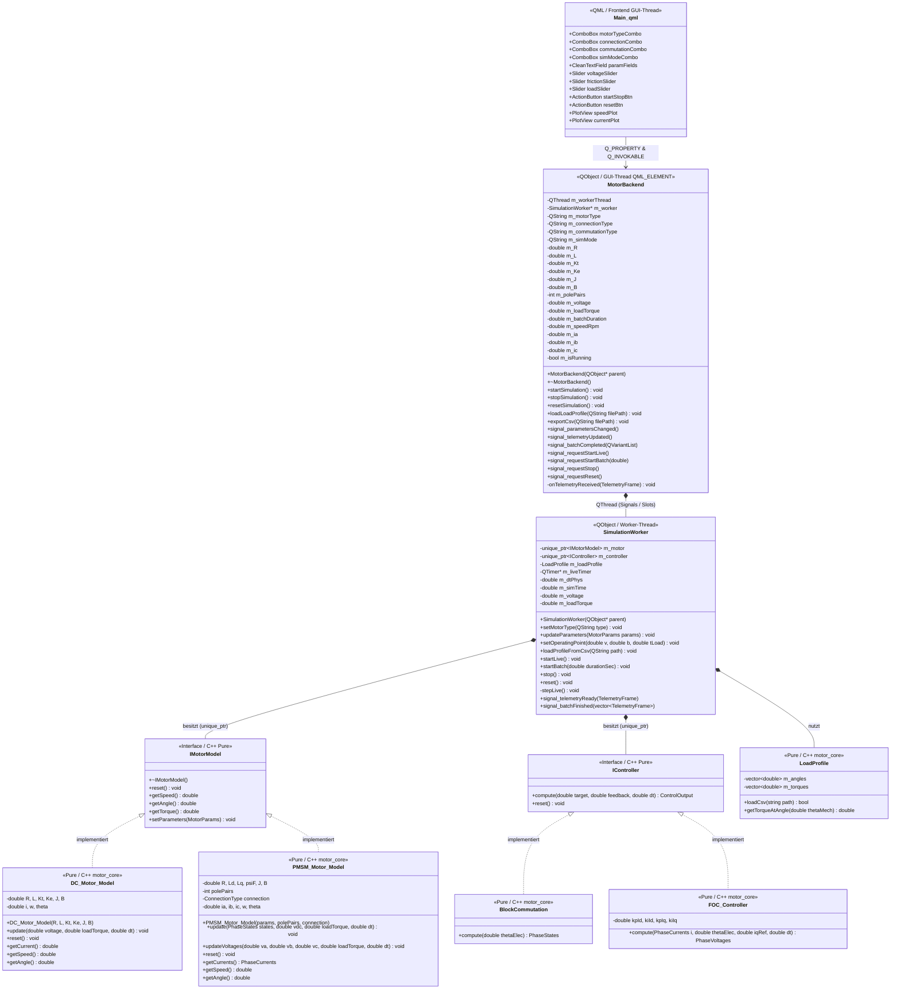
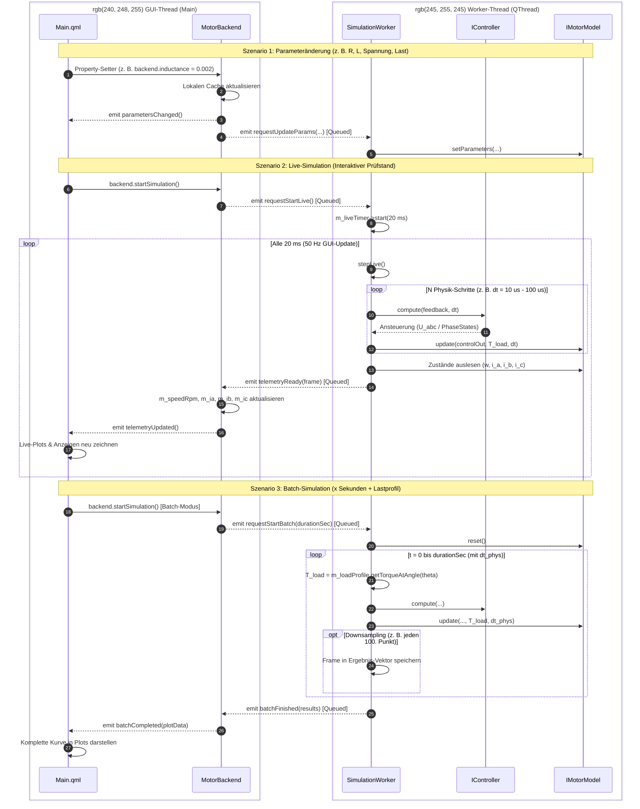

# Software-Architektur: Motor Application

## 1. Architektur-Übersicht

Die Applikation folgt einer strikten **3-Schichten-Architektur** mit klarer Trennung zwischen Benutzeroberfläche, Thread-Orchestrierung und physikalischer Simulation:

| Schicht | Verzeichnis | Thread | Technologie | Verantwortung |
| :--- | :--- | :--- | :--- | :--- |
| **Frontend** | `frontend/` | GUI-Thread | QML / Qt Quick | Darstellung, Benutzereingaben, Live-Plots, Toolbar |
| **Bridge** | `bridge/` | GUI- & Worker-Thread | Qt 6 C++ (`QObject`, `QThread`) | Property-Bindings, Thread-Trennung, Simulations-Loop, CSV/Preset-Handling |
| **Backend** | `backend/` | Worker-Thread | Reines C++17 (`motor_core`) | Motormodelle (DC, PMSM), Kommutierung/FOC, Lastprofile – **frei von Qt** |

### Zentrale Design-Prinzipien
* **Keine Qt-Abhängigkeit im Backend:** `motor_core` bleibt als eigenständige statische Bibliothek (`lib`) voll testbar (CLI-Tests, spätere Unit-Tests, Wiederverwendung auf Embedded-Targets).
* **Thread-Sicherheit ohne Mutexes:** `MotorBackend` (GUI-Thread) und `SimulationWorker` (Worker-Thread) kommunizieren ausschließlich über asynchrone Qt Signals & Slots (`QueuedConnection`).
* **Polymorphe Motormodelle:** Über ein gemeinsames Interface (`IMotorModel`) kann der Worker beliebige Motortypen (DC, PMSM) austauschen, ohne die Simulationsschleife umzubauen.

---

## 2. UML-Klassendiagramm (Ziel-Architektur)

---

## 3. UML-Sequenzdiagramm (Datenfluss & Threading)

Das Sequenzdiagramm zeigt die drei zentralen Laufzeit-Szenarien:
1. **Parameter-Update:** Sofortige, thread-sichere Übernahme von GUI-Eingaben.
2. **Live-Modus (Interaktiv):** Kontinuierliche Echtzeit-Simulation mit 50 Hz GUI-Refresh.
3. **Batch-Modus (Zeitgesteuert):** Schnelle Berechnung über $x$ Sekunden inkl. winkelabhängigem Lastprofil und geschlossenem Plot-Export.

---

## 4. Erweiterungs-Checkliste (Neuer Parameter)

Beim Hinzufügen eines neuen Motor- oder Betriebsparameters werden immer dieselben 4 Stellen angepasst:
1. **Backend (`backend/include/*.h`):** Getter/Setter im Modell ergänzen (inkl. Wertebereichsprüfung, z. B. $L > 0, J > 0$).
2. **Worker (`bridge/SimulationWorker`):** Slot zur Übernahme in `m_motor` anlegen.
3. **Bridge (`bridge/MotorBackend`):** `Q_PROPERTY`, Setter, `request*`-Signal und `connect(...)` im Konstruktor ergänzen.
4. **Frontend (`frontend/Main.qml`):** Textfeld oder Slider an das neue `backend.<property>` binden.